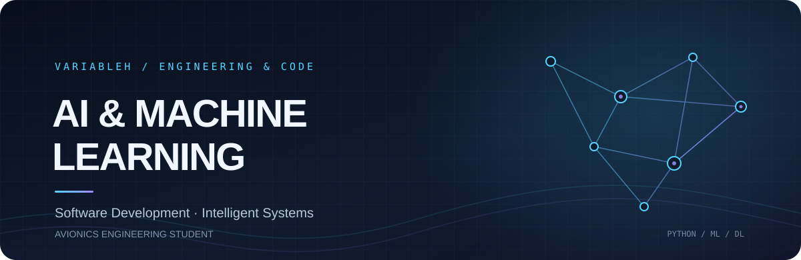

<!--
  Profile README for @variableh
  Focus: AI, Machine Learning, and Software Development
-->

  

   

  

  

    
    
  

---

## About

I'm an **Avionics Engineering student** with a strong focus on **Artificial Intelligence, Machine Learning, and Software Development**.

I enjoy working with data, developing predictive models, and turning machine learning concepts into practical applications.

My current focus is strengthening my foundations in Machine Learning, exploring Deep Learning with **PyTorch**, and learning to build and deploy reliable AI-powered applications.

My engineering background also shapes my interest in intelligent systems and applying AI to real-world engineering problems.

## Tech Stack

**Working with**

  

**Currently learning**

  

Core tools: Python · NumPy · Pandas · Scikit-learn · SQL · Matplotlib · Seaborn · Git · Linux · Jupyter

## Featured Project

### NASA C-MAPSS — Predictive Maintenance

An end-to-end machine learning study using NASA's simulated turbofan engine data. The project explores **Remaining Useful Life (RUL) regression** and **engine health-state classification**, with engine-level splitting and grouped cross-validation to reduce data leakage.

| Regression — Random Forest | Classification — Logistic Regression |
|:---:|:---:|
| **MAE:** 13.14 cycles | **Critical precision:** 0.86 |
| **R²:** 0.81 | **Critical recall:** 0.76 |

Results are from the project's held-out test set. This is a benchmark study on simulated FD001 data, not a deployed aircraft maintenance system.

[Explore the project →](https://github.com/variableh/nasa-cmapss-predictive-maintenance)

## GitHub Activity

  
  

  

## Connect

  

  AI · Machine Learning · Software Development · Intelligent Systems

